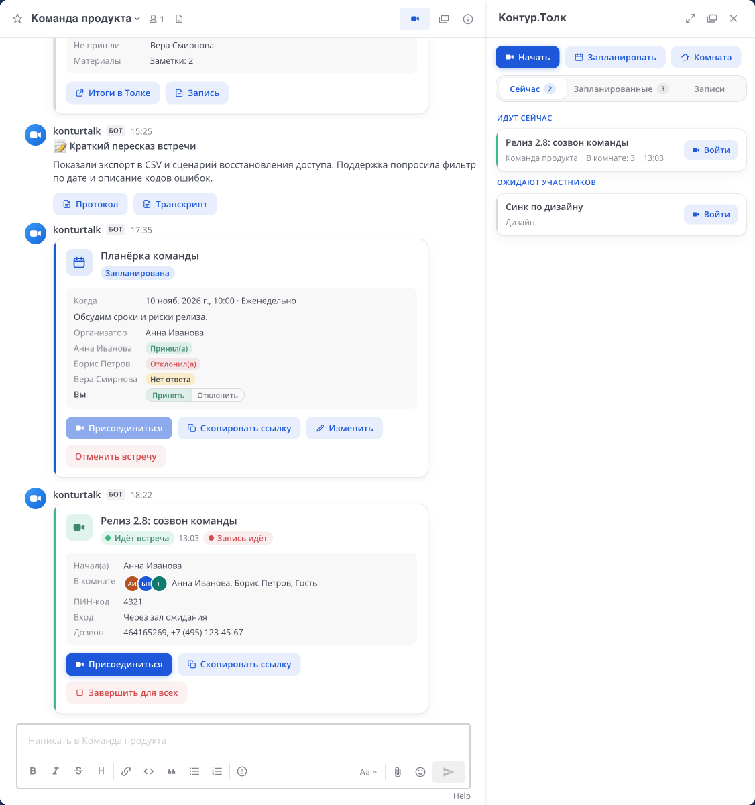
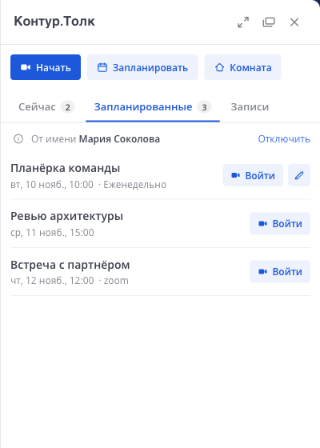
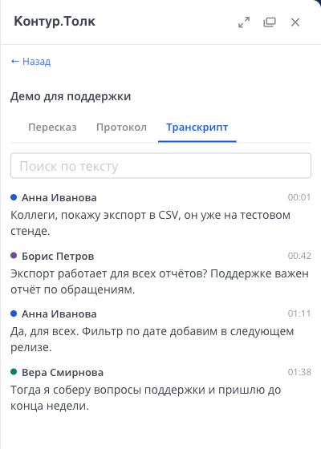
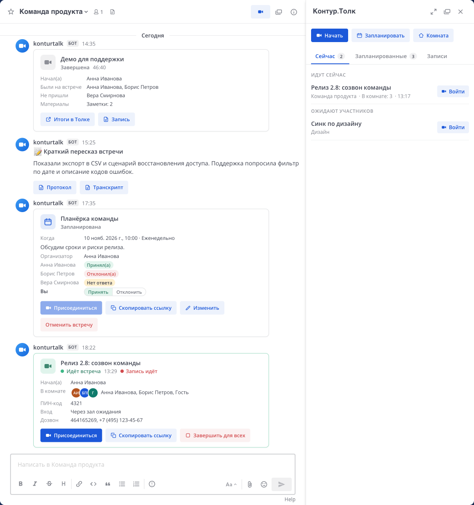
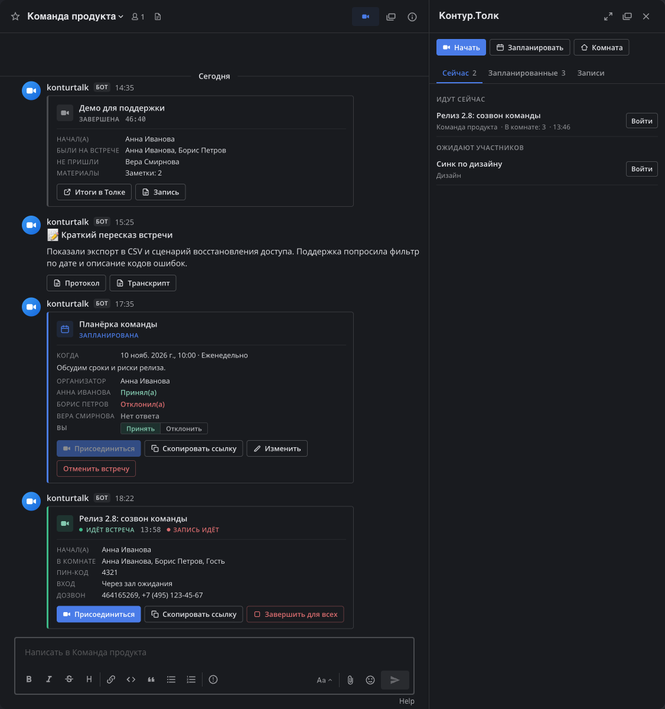

# Kontur Talk for Mattermost

[](https://github.com/moonssword/mattermost-plugin-ktalk/actions/workflows/ci.yml)
[](LICENSE)


**English** · [Русский](README.ru.md)

A Mattermost plugin for [Kontur Talk](https://kontur.ru/talk) (Контур.Толк), a Russian video conferencing service. Start and join meetings from any channel, ring colleagues in direct messages, schedule meetings in the Talk calendar, and get recordings, transcripts and AI summaries back in the meeting thread.

> [!NOTE]
> This is an independent, community-built plugin. It is not affiliated with, endorsed by or supported by SKB Kontur. Kontur Talk is a trademark of its owner.



## Features

- **One-click meetings.** A channel header button, `/talk start [topic]`, a button in the channel intro, and *Discuss in Talk* in the message menu. In a channel the meeting link is posted; in a direct or group chat the call button asks whether to ring or only post the link (only a call opens the room for the caller; a posted link leaves them in the chat), and `/talk link [topic]` posts it without ringing.
- **Live meeting cards.** Status, duration, who is in the room, PIN, dial-in numbers, and *Join*, *Start recording* and *End for everyone* buttons, shown to those Talk allows to use them.
- **Calls in direct and group messages.** The call button offers to ring or only send a meeting link. Recipients of a call get it inside Mattermost: a ringing window, a desktop notification and a mobile push. People with a Talk account can also be rung in the Talk app. Answers show up on the caller's card.
- **Scheduling.** `/talk schedule` with time, recurrence chosen as in Talk (weekdays, every N days, weeks or months on chosen days, until a date or for a number of meetings), participants, external guests, PIN, waiting room and auto-recording. The card tracks invitees' answers, and the bot posts a reminder before the start.
- **Answering invitations.** With a personal Talk key, invitees accept or decline right in the attendee list on the card. For a recurring meeting the answer applies to the whole series.
- **Recordings and summaries.** The meeting thread is told when the recording and the summary are ready; only the author and participants can open them. The *Recordings* tab lists them for a chosen period of up to a month; minutes and a searchable transcript open in the sidebar.
- **Sidebar.** *Now*, *Upcoming* and *Recordings* tabs, quick start and a personal room. *Start* posts a meeting link; in a direct or group chat an arrow next to it offers *Call*. Recurring meetings collapse into one row, and meetings you organize can be edited from *Upcoming*. A link nobody has opened for two hours leaves *Now* and comes back if someone joins later. The sliders button opens the plugin settings inside the sidebar; they are the same settings as in **Settings → Контур.Толк**.
- **Presence.** While someone is in a meeting, their Mattermost status reads "In a Kontur Talk meeting". The profile popover shows a colleague's Talk status and a *Call in Talk* button.
- **Three visual styles,** in light and dark themes, chosen by the administrator and overridable per user.

| Upcoming meetings | Recording transcript |
|---|---|
|  |  |

The user interface is in Russian, with an English translation for users whose Mattermost language is not Russian. System Console settings and bot messages are in Russian.

## Requirements

- Mattermost Server 11.7 or later.
- A cloud Kontur Talk space (`https://<space>.ktalk.ru`, reachable over HTTPS) and an administrator account in it to create an API key.
- Optional: a Mattermost site URL reachable from the internet, for webhooks.

## Installation

1. Download `konturtalk-<version>.tar.gz` from [Releases](https://github.com/moonssword/mattermost-plugin-ktalk/releases), or build it with `make bundle`.
2. In Mattermost, go to **System Console → Plugins → Plugin Management** and upload the bundle.
3. In Kontur Talk, create a key under **Administration → API keys → Add**. The key is shown only once, for one hour.
4. In **System Console → Plugins → Контур.Толк**, enter the space address and the key. The *Connection* block shows the key's expiry and any missing scopes.

Without a key the plugin works in link-only mode: it creates a room link but does not manage the room.

### API key scopes

| Scope | Access | Used for |
|---|---|---|
| `rooms` | read & write | watching rooms, calls, quick meetings of users without a personal key |
| `profiles` | read | matching users by email, presence |
| `calendar` | read | keeping scheduled meetings in step; planning uses personal keys |
| `recording` | read & write | recordings, transcripts, summaries |
| `activeRecordings` | read & write | the *Start recording* button |
| `reporting` | read | meeting results, finished conferences |
| `onlineStats` | read | usage counters and plan expiry in the console |
| `webhooks` | read & write | optional, see [Status updates](#status-updates) |

Grant only these scopes; the plugin needs nothing else.

## How it works

### Who may do what

Rights come from Talk, not from Mattermost roles: channel admins and system admins get nothing extra.

- **Running a meeting** (recording, ending for everyone, PIN, guest access, waiting room) is for the moderators of its room in Talk. Talk answers this itself when the plugin reads the room with the user's personal key.
- **Changing or cancelling a scheduled meeting** is for the organizer of its event in Talk.
- **Answering an invitation** is for attendees of the event in Talk.
- **Stopping a call that rings** is for the person calling.

Every action is checked against Talk at the moment it is made; the buttons on a card only reflect it.

### Two keys: the user's and the space's

Everything a user does, the plugin does with that user's **personal Talk key**, so Talk sees the person in every action and applies their own rights:

| Action | Key |
|---|---|
| Start a meeting, call: creating the room | personal |
| Your own room | personal |
| PIN, guests, waiting room, *End for everyone* | personal |
| Planning: create, change, cancel, answer invitations, *Upcoming* | personal |
| *Recordings* tab, summary, minutes, transcript | personal, plus a check of the recording's grants |
| Ringing in the Talk app | space: Talk does not allow it to personal keys |
| Starting a recording and its chosen access | space, only for a room moderator as Talk tells through the personal key |

**The space key** stays for what the plugin does as a whole: webhooks, watching rooms and recordings, notices in threads, matching users by email, "in a meeting" statuses and the panel in the System Console. It also reads a recording's grants: Talk serves a recording's summary to any user of the space with a personal key, and shows grants to no personal key.

**A personal key** is issued in Talk (*Settings → API keys → Issue key*) and pasted with the settings button in the Kontur Talk sidebar or in **Settings → Контур.Толк**. Any action without a key opens the key form in the sidebar and then offers to continue. The plugin checks that the key belongs to the same Talk user, stores it encrypted, and disconnects it if Talk stops accepting it.

**Without a personal key** a user keeps the least the plugin is for: starting a meeting or a call (the space key then creates the room, with the user as its moderator), joining meetings, copying links and answering calls. Running a meeting, planning, your own room and recordings need a key. A card tells the person who started a meeting without a key that running it needs one.

**Getting started.** Until a key is connected, the sidebar asks for one right away: the top of the *Now* tab holds the key form with a hint where to issue the key. *Later* folds it into one line, "Planning, running meetings and recordings are available with a personal key · Connect key", which can be hidden too. In the System Console, the *Connection* block shows how many users of the plugin have connected a key. For the first rollout, *Test mode* can limit the plugin to a pilot group.

**Mattermost users are matched to Talk users by email.** By default only verified addresses count; otherwise anyone could set a colleague's address. Addresses of users who sign in through SAML, LDAP or OAuth come from the identity provider and cannot be changed in Mattermost, so they always count as verified. For password accounts on a server that cannot send email, verify addresses with `mmctl user verify <username>`. The address in Mattermost must be the same as in Talk. The profile behind a personal key does not name the Talk user's key, so a personal key is accepted only when its owner's name matches the user found by email.

### Recordings

Talk decides who may open a recording. For every recording the plugin asks Talk who holds a role on it (the author, the meeting's participants and anyone the owner shared it with) and shows the recording, summary, minutes and transcript only to them; buttons for a recording are hidden from everyone else. Channel membership grants nothing, and system administrators get no exception. The meeting thread receives notices that a recording or a summary is ready, never the summary text.

The *Recordings* tab shows the same list as Talk's recordings page, including recordings shared with you; it needs a personal key. Summaries and minutes are shown as Talk shows them: headlines, topics, and tasks with owners and deadlines.

*Start recording* on a card asks who may open the recording, with Talk's own choices:

| Choice | Who opens it in Talk | Who sees it in Mattermost |
|---|---|---|
| Only me | The author | The author |
| Only those present | The author and the participants with a Talk account | The same people |
| Anyone in the space with the link | Any colleague with the link | The author and the participants |
| Anyone on the internet with the link | Anyone with the link | The author and the participants |

Talk accepts the choice only once a recording is finished, so the plugin applies it then; if Talk refuses, the person who started the recording gets a message. The *Default recording access* setting picks the preselected choice and the access of automatic recordings. Recordings started in Talk keep the access chosen there. Stopping or pausing a recording is possible only in Talk: its API has no such method.

### Status updates

The plugin polls the Talk API every 30 seconds: a card turns live within half a minute of the first person joining and closes after the room has been empty for two checks in a row. No extra setup is required.

Webhooks make updates near-instant. They need the `webhooks` scope (Kontur Talk support enables it on request), a Mattermost site URL reachable from the internet, and the *Use webhooks* setting followed by *Register webhook* in the *Connection* block. Deliveries are authenticated with a secret header. Talk allows ten webhook creations per space per day, so the plugin reuses an existing registration.

### Calendars

The plugin schedules through the Kontur Talk calendar and never connects to mail calendars directly. The Talk space administrator can make Exchange / Microsoft 365 or a CalDAV calendar the space's primary calendar; meetings scheduled from Mattermost then appear there, and answers given there show up on the card. Answering from Mattermost works only when the space uses the Talk calendar.

### Test mode

Test mode limits the plugin to the users listed in *Testers*. System administrators are not included by default, since a large organisation may have many of them; the *Access for system administrators* setting adds them all. Everyone else sees no buttons or sidebar, receives no calls, and commands and the API refuse them. The System Console keeps working for administrators either way. Cards that were already posted stay visible to the channel, so test in a separate channel.

## Visual styles

The *Default style* setting picks the look of cards and the sidebar; users can choose their own in **Settings → Контур.Толк** or with `/talk settings style cards`.

| System | Compact, dark theme |
|---|---|
|  |  |

## Commands

`/talk help` lists all commands. `/talk start [topic]` starts a meeting and, in a direct or group chat, rings; `/talk link [topic]` only posts the link. `pin`, `guests`, `lobby`, `record` and `end` act on the channel's latest active meeting and are available to the moderators of its room in Talk. `/talk connect` opens the personal key form.

## Working alongside Mattermost Calls

The plugins do not interfere: Calls keeps its `/call` command, posts and calls. With both installed, Mattermost merges the two call buttons in the channel header into one menu. Mattermost labels that menu "Call" in every language; the label comes from Mattermost itself and cannot be translated by plugins.

## Known limitations

- Recording can start only while a registered Talk user is in the room; this is how the Talk API works.
- A recording can be stopped or paused only in Talk, and its access can be changed only once it is finished.
- Meeting results reach Talk's history a few minutes after the end. Conferences with guests only are not recorded in history.
- Talk cannot turn a recurring meeting into a single one or back; the plugin suggests cancelling and scheduling again.
- `/talk` stays in autocomplete for everyone, even in test mode: Mattermost cannot hide a command per user.

## Development

The server is written in Go and builds in a container, so a local Go toolchain is not required. The web app is React and TypeScript. See [CONTRIBUTING.md](CONTRIBUTING.md) for the layout and conventions.

```bash
make test        # server tests (in Docker) and web app tests
make lint        # golangci-lint and TypeScript checks
make bundle      # dist/konturtalk-<version>.tar.gz
make deploy      # build and install into a local Docker Mattermost via mmctl --local
make talk-check  # expiry and scopes of the key in .env (see .env.example)
```

Talk API reference: [developer.kontur.ru/doc/talk.public.api](https://developer.kontur.ru/doc/talk.public.api).

## Security

Please report vulnerabilities privately; see [SECURITY.md](SECURITY.md).

## License

[MIT](LICENSE)
