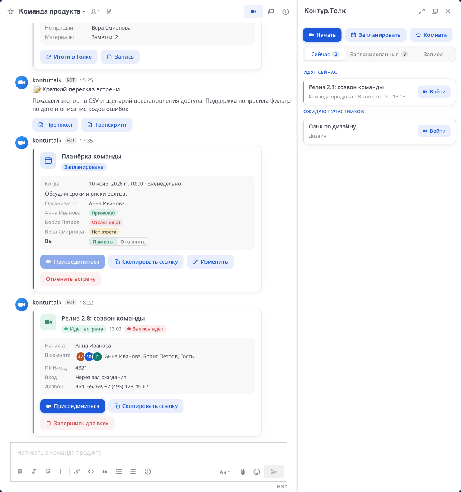
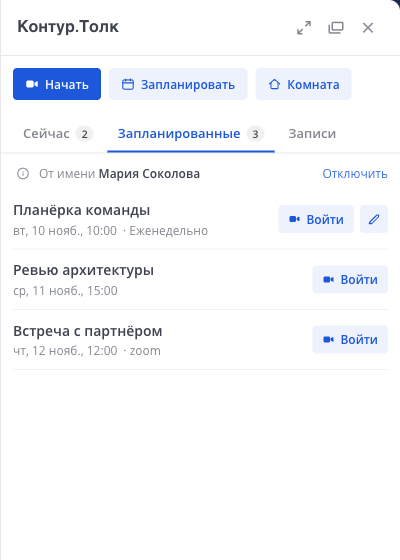
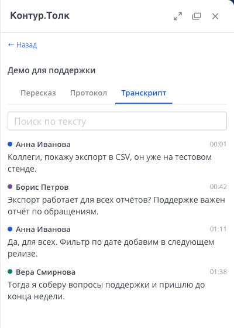
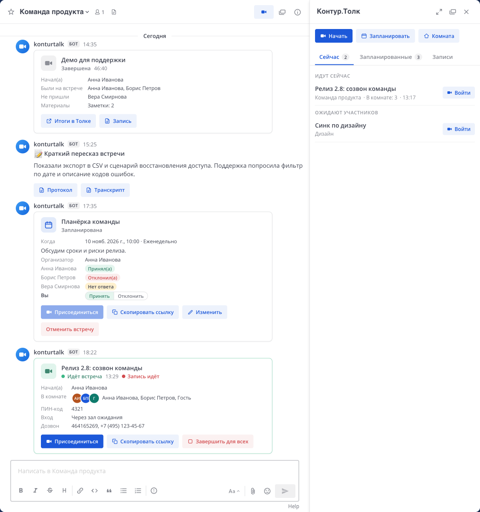
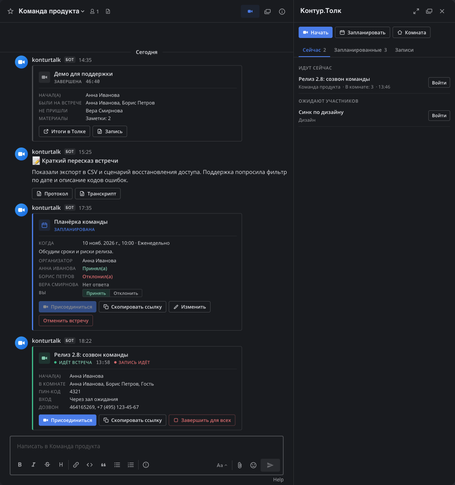

# Контур.Толк для Mattermost

[](https://github.com/moonssword/mattermost-plugin-ktalk/actions/workflows/ci.yml)
[](LICENSE)


[English](README.md) · **Русский**

Плагин Mattermost для [Контур.Толка](https://kontur.ru/talk). Встречи запускаются из любого канала, коллегам в личных сообщениях можно позвонить, встречи планируются в календаре Толка, а запись, транскрипт и краткий пересказ приходят в тред встречи.

> [!NOTE]
> Это независимый проект сообщества. Он не связан с СКБ Контур, не одобрен и не поддерживается им. Контур.Толк — товарный знак правообладателя.



## Возможности

- **Встреча в один клик.** Кнопка в шапке канала, `/talk start [тема]`, кнопка в приветствии канала и пункт «Обсудить в Толке» в меню сообщения. В канал отправляется ссылка на встречу. В личном или групповом чате кнопка звонка спрашивает, позвонить или только отправить ссылку, а `/talk link [тема]` отправляет ссылку без звонка.
- **Живая карточка в канале.** Статус, длительность, кто в комнате, ПИН-код, дозвон, кнопки «Присоединиться», «Начать запись», «Завершить для всех». Кнопки видят те, кому Толк разрешает ими пользоваться.
- **Звонки в личных и групповых чатах.** Кнопка звонка предлагает позвонить или только отправить ссылку на встречу. При звонке собеседникам приходит входящий вызов прямо в Mattermost: окно со звуком, уведомление на рабочем столе и на телефоне. Тем, у кого есть аккаунт в Толке, звонок можно дублировать в приложение Толка. Ответы видны на карточке звонящего.
- **Планирование.** `/talk schedule`: время, повторение как в Толке (по будням, каждые N дней, недель или месяцев в выбранные дни, до даты или по числу встреч), участники, внешние адреса, ПИН-код, зал ожидания, автозапись. Карточка показывает ответы приглашённых, бот напоминает о начале.
- **Ответ на приглашение.** С личным ключом Толка приглашённый принимает или отклоняет встречу прямо в списке участников на карточке. Ответ на повторяющуюся встречу действует на всю серию.
- **Записи и пересказ.** В тред встречи приходит уведомление о готовой записи и пересказе, открыть их могут только автор и участники. Вкладка «Записи» показывает их за выбранный период до месяца, протокол и транскрипт с поиском открываются в правой панели.
- **Правая панель.** Вкладки «Сейчас», «Запланированные», «Записи», быстрый старт и постоянная комната. «Начать» отправляет ссылку на встречу, а в личном или групповом чате стрелка рядом предлагает «Позвонить». Повторяющаяся встреча занимает одну строку, встречу, которую вы организуете, можно изменить прямо во вкладке «Запланированные».
- **Статусы.** Пока человек на встрече, его статус в Mattermost — «На встрече в Контур.Толке». В карточке профиля коллеги видно его состояние в Толке и есть кнопка «Позвонить в Толке».
- **Три стиля оформления** в светлой и тёмной теме. Стиль по умолчанию выбирает администратор, пользователь может выбрать свой.

| Запланированные встречи | Транскрипт записи |
|---|---|
|  |  |

Интерфейс на русском. Пользователям с другим языком Mattermost веб-интерфейс плагина показывается на английском. Настройки в системной консоли и сообщения бота только на русском.

## Требования

- Сервер Mattermost 11.7 или новее.
- Облачное пространство Контур.Толка (`https://<пространство>.ktalk.ru`, доступное по HTTPS) и учётная запись администратора в нём, чтобы создать API-ключ.
- Необязательно: адрес Mattermost, доступный из интернета, — для вебхуков.

## Установка

1. Скачайте `konturtalk-<версия>.tar.gz` на странице [Releases](https://github.com/moonssword/mattermost-plugin-ktalk/releases) или соберите командой `make bundle`.
2. Загрузите пакет в **Системная консоль → Плагины → Управление плагинами**.
3. В Толке создайте ключ: **Управление → API-ключи → Добавить**. Ключ показывается один раз и только в течение часа.
4. В **Системная консоль → Плагины → Контур.Толк** укажите адрес пространства и ключ. Блок «Подключение» покажет срок ключа и недостающие области.

Без ключа плагин работает в режиме ссылок: создаёт ссылку на комнату, но не управляет ей. Для переноса с тестового пространства на рабочее достаточно поменять адрес и ключ в настройках.

### Области ключа

| Область | Уровень | Для чего |
|---|---|---|
| `rooms` | чтение и изменение | комнаты, ПИН-код, зал ожидания, звонки |
| `profiles` | чтение | сопоставление пользователей по почте, статусы |
| `calendar` | чтение и изменение | планирование |
| `recording` | чтение и изменение | записи, транскрипт, пересказ |
| `activeRecordings` | чтение и изменение | кнопка «Начать запись» |
| `reporting` | чтение | итоги встречи, завершённые конференции |
| `onlineStats` | чтение | счётчики и срок тарифа в консоли |
| `webhooks` | чтение и изменение | необязательно, см. [Обновление статусов](#обновление-статусов) |

Другие области плагину не нужны, лучше их не выдавать.

## Как это работает

### Кто что может

Права берутся из Толка, а не из ролей Mattermost: администраторы канала и системные администраторы дополнительных прав не получают.

- **Управлять встречей** (запись, завершение для всех, ПИН-код, гостевой доступ, зал ожидания) могут модераторы её комнаты в Толке.
- **Изменить или отменить запланированную встречу** может организатор события в Толке.
- **Ответить на приглашение** могут участники события в Толке, с личным ключом.
- **Отменить исходящий звонок** может тот, кто звонит.

Каждое действие проверяется в Толке в момент выполнения, кнопки на карточке лишь показывают результат.

### Действия от имени пользователей

У Talk API нет OAuth для сторонних приложений, поэтому плагин опирается на ключ пространства и на адрес почты:

1. **Ключ пространства** управляет комнатами, звонками и записями. В каждом запросе он называет реального человека: модератора комнаты, звонящего, инициатора записи.
2. **Пользователь Mattermost связывается с пользователем Толка по адресу почты.** По умолчанию учитываются только подтверждённые адреса, иначе можно указать чужой адрес и получить доступ к чужому календарю. Адреса пользователей, входящих через SAML, LDAP или OAuth, приходят от провайдера входа и не меняются в Mattermost, поэтому всегда считаются подтверждёнными. Для учётных записей с паролем на сервере без отправки писем подтвердите адрес командой `mmctl user verify <логин>`. Адрес в Mattermost должен совпадать с адресом в Толке.
3. **Календарь** открывается по адресу через ключ пространства, поэтому пользователям не нужно нигде входить.

**Личный ключ Толка** подключать не обязательно. Пользователь выпускает его в Толке («Настройки → API ключи → Выпустить ключ») и вставляет в «Настройки → Контур.Толк» или на вкладке «Запланированные». С ним встречи создаются в календаре пользователя от его имени, а на приглашения можно отвечать из Mattermost. Плагин проверяет, что ключ выпущен тем же пользователем Толка, хранит его в зашифрованном виде и отключает, если Толк перестал его принимать. Настройка «Календарь только с личным ключом» запрещает планирование через ключ пространства тем, кто ключ не подключил.

### Записи

Кто может открыть запись, решает Толк. Для каждой записи плагин спрашивает у Толка, у кого есть роль на ней: у автора, участников встречи и тех, с кем владелец поделился записью. Запись, пересказ, протокол и транскрипт видят только они, остальным кнопки записи не показываются. Членство в канале доступа не даёт, исключений для системных администраторов нет. В тред встречи приходят только уведомления о готовой записи и пересказе, без текста пересказа.

Кнопка «Начать запись» на карточке спрашивает, кому будет доступна запись, с теми же вариантами, что в Толке:

| Вариант | Кто откроет в Толке | Кто увидит в Mattermost |
|---|---|---|
| Только мне | Автор | Автор |
| Только присутствующим | Автор и участники с аккаунтом Толка | Те же люди |
| Всем в пространстве по ссылке | Любой сотрудник со ссылкой | Автор и участники |
| Всем в интернете по ссылке | Любой со ссылкой | Автор и участники |

Толк принимает выбор только после завершения записи, поэтому плагин применяет его тогда же. Если Толк откажет, начавшему запись придёт сообщение. Настройка «Доступ к записи по умолчанию» задаёт вариант, выбранный заранее, и доступ автоматических записей. Записи, начатые в Толке, сохраняют доступ, выбранный там. Остановить запись или поставить её на паузу можно только в Толке: в его API таких методов нет.

### Обновление статусов

Плагин опрашивает API Толка каждые 30 секунд: карточка переходит в «Идёт встреча» в пределах полуминуты после входа первого участника и закрывается, когда комната пуста две проверки подряд. Дополнительная настройка не нужна.

Вебхуки делают обновление почти мгновенным. Для них нужны область `webhooks` у ключа (её включает поддержка Контур.Толка по запросу), адрес Mattermost, доступный из интернета, и настройка «Использовать вебхуки» с кнопкой «Зарегистрировать вебхук» в блоке «Подключение». Запросы от Толка проверяются по секретному заголовку. Толк разрешает создавать не больше 10 вебхуков в сутки на пространство, поэтому плагин переиспользует уже созданный.

### Календари

Плагин планирует встречи через календарь Контур.Толка и не подключается к почтовым календарям напрямую. Администратор пространства может сделать основным календарём Exchange / Microsoft 365 или CalDAV, например Яндекс Календарь. Тогда встречи из Mattermost появляются там, а ответы, данные там, видны на карточке. Отвечать на приглашения из Mattermost можно, только если пространство работает на календаре Толка.

### Режим тестирования

Пока режим включён, плагином пользуются только пользователи из списка «Тестировщики». Системные администраторы по умолчанию в него не входят: в большой организации их бывает много. Настройка «Доступ системным администраторам» открывает плагин им всем. Остальные не видят кнопок и панели, звонки им не приходят, команды и API им отказывают. Системная консоль у администраторов работает в любом случае. Уже опубликованные карточки видны всему каналу, поэтому проверяйте в отдельном канале.

## Стили оформления

Вид карточек и панели задаёт настройка «Стиль по умолчанию». Пользователь выбирает свой в **Настройки → Контур.Толк** или командой `/talk settings style cards`.

| «Системный» | «Компактный», тёмная тема |
|---|---|
|  |  |

## Команды

Полный список выводит `/talk help`. `/talk start [тема]` начинает встречу и в личном или групповом чате звонит, `/talk link [тема]` только отправляет ссылку. Команды `pin`, `guests`, `lobby`, `record`, `end` действуют на последнюю активную встречу канала и доступны модераторам её комнаты в Толке. `/talk connect` открывает форму личного ключа.

## Вместе с Mattermost Calls

Плагины не мешают друг другу: у Calls своя команда `/call`, свои сообщения и звонки. Когда установлены оба, Mattermost объединяет кнопки звонка в шапке канала в одно меню. Подпись этого меню «Call» не переводится: её задаёт сам Mattermost, плагины её изменить не могут.

## Ограничения

- Запись можно начать, только когда в комнате есть зарегистрированный пользователь Толка: так работает API.
- Остановить запись или поставить её на паузу можно только в Толке, а изменить её доступ — только после завершения записи.
- Итоги встречи появляются в истории Толка через несколько минут после завершения. Конференция только с гостями в историю не попадает.
- Повторяющуюся встречу нельзя превратить в разовую и наоборот: Толк это запрещает, плагин предложит отменить и создать заново.
- Команда `/talk` остаётся в автодополнении у всех даже в режиме тестирования: Mattermost не умеет скрывать команду для отдельных людей.

## Разработка

Сервер написан на Go и собирается в контейнере, локальный Go не нужен. Веб-часть — React и TypeScript. Структура и правила — в [CONTRIBUTING.md](CONTRIBUTING.md).

```bash
make test        # тесты сервера (в Docker) и веб-части
make lint        # golangci-lint и проверка типов
make bundle      # dist/konturtalk-<версия>.tar.gz
make deploy      # сборка и установка в локальный Docker Mattermost через mmctl --local
make talk-check  # срок и области ключа из .env (см. .env.example)
```

Описание API Толка: [developer.kontur.ru/doc/talk.public.api](https://developer.kontur.ru/doc/talk.public.api).

## Безопасность

Об уязвимостях сообщайте приватно, см. [SECURITY.md](SECURITY.md).

## Лицензия

[MIT](LICENSE)
